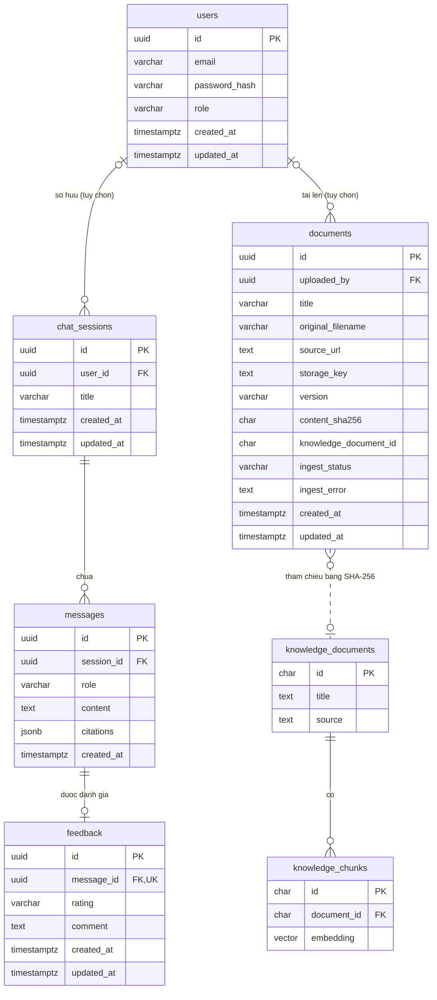

# Phase 2 - ERD du lieu nghiep vu

Thiet ke cho PostgreSQL phuc vu dang nhap, lich su chat, feedback va quan ly
tai lieu. Day la contract cho Flyway migration
`backend/src/main/resources/db/migration/V1__business_entities.sql` va Spring
Data JPA o cac task tiep theo.

## ERD



Duong cham `documents` -> `knowledge_documents` la tham chieu logic, **khong
phai foreign key**. Hai bang `knowledge_*` da duoc tao boi migration Phase 1
`infrastructure/postgres/migrations/001_knowledge_base.sql`. Nam bang `documents`
khac `knowledge_documents`: bang dau luu vong doi quan tri/upload; bang sau va
`knowledge_chunks` la corpus retrieval do Python pipeline quan ly.

## Cot va rang buoc de xuat

`uuid` la khoa chinh do ung dung tao. `timestamptz` luu UTC; `created_at` mac
dinh `now()` va `updated_at` duoc cap nhat khi ban ghi thay doi. Tru cac truong
ghi `nullable`, cot con lai bat buoc (`NOT NULL`).

| Bang | Cot | Kieu / rang buoc | Y nghia |
|---|---|---|---|
| `users` | `id` | `uuid` PK | Dinh danh tai khoan. |
| | `email` | `varchar(320)` NOT NULL, unique theo `lower(email)` | Chuan hoa trim/lower truoc khi ghi; khong co hai tai khoan khac hoa-thuong. |
| | `password_hash` | `varchar(255)` | Chi luu hash, khong luu mat khau goc. |
| | `role` | `varchar(16)` CHECK `STUDENT`, `ADMIN` | Role cho Phase 3. |
| | `created_at`, `updated_at` | `timestamptz` | Thoi gian tai khoan. |
| `chat_sessions` | `id` | `uuid` PK | Mot cuoc hoi thoai. |
| | `user_id` | `uuid` nullable FK -> `users.id`, `ON DELETE SET NULL` | Cho phep chat an danh neu API quyet dinh mo public; xoa tai khoan van giu lich su da an danh hoa. |
| | `title` | `varchar(255)` nullable | Ten hien thi, co the sinh tu cau hoi dau tien. |
| | `created_at`, `updated_at` | `timestamptz` | Sap xep lich su chat. |
| `messages` | `id` | `uuid` PK | Mot luot user hoi hoac assistant tra loi. |
| | `session_id` | `uuid` FK -> `chat_sessions.id`, `ON DELETE CASCADE` | Xoa session se xoa message cua no. |
| | `role` | `varchar(16)` CHECK `USER`, `ASSISTANT` | Phan biet nguoi gui; khong dung role cua bang users. |
| | `content` | `text` CHECK khong rong | Noi dung cau hoi/cau tra loi. |
| | `citations` | `jsonb` NOT NULL DEFAULT `[]`, CHECK la array | Snapshot nguon tai thoi diem tra loi; user message dung `[]`. |
| | `created_at` | `timestamptz` | Thu tu cac luot chat. |
| `feedback` | `id` | `uuid` PK | Mot danh gia tren cau tra loi. |
| | `message_id` | `uuid` NOT NULL UNIQUE FK -> `messages.id`, `ON DELETE CASCADE` | Toi da mot feedback cho moi assistant message; co the sua danh gia. |
| | `rating` | `varchar(16)` CHECK `HELPFUL`, `NOT_HELPFUL` | Danh gia 2 muc. |
| | `comment` | `text` nullable | Nhan xet tuy chon. |
| | `created_at`, `updated_at` | `timestamptz` | Thoi gian danh gia. |
| `documents` | `id` | `uuid` PK | ID on dinh cua ban ghi quan tri. |
| | `uploaded_by` | `uuid` nullable FK -> `users.id`, `ON DELETE SET NULL` | Admin upload; tai lieu seed/import co the khong co user. |
| | `title` | `varchar(500)` CHECK khong rong | Ten hien thi. |
| | `original_filename` | `varchar(500)` nullable | Ten file goc neu la upload. |
| | `source_url` | `text` nullable | URL nguon neu lay tu web; khac duong dan file local. |
| | `storage_key` | `text` nullable | Duong dan/key cua file da luu ben ngoai DB. |
| | `version` | `varchar(100)` nullable | So QD/ngay phien ban do admin xac minh; khong tu suy doan. |
| | `content_sha256` | `char(64)` nullable, CHECK hex lowercase | Hash file goc de doi chieu tai lieu da nap. |
| | `knowledge_document_id` | `char(64)` nullable, CHECK hex lowercase | ID SHA-256 cua tai lieu trong corpus Phase 1 sau khi match/xac nhan. |
| | `ingest_status` | `varchar(16)` CHECK `PENDING`, `PROCESSING`, `READY`, `NEEDS_REVIEW`, `FAILED` | Trang thai quan tri; khac `knowledge_documents.legal_status`. |
| | `ingest_error` | `text` nullable | Ly do that bai de admin xu ly. |
| | `created_at`, `updated_at` | `timestamptz` | Thoi gian cap nhat tai lieu. |

## Quan he va quy tac du lieu

- `users` 1:N `chat_sessions` va 1:N `documents`; ca hai FK co the NULL.
- `chat_sessions` 1:N `messages`; `messages` 1:0..1 `feedback`. `Feedback`
  constructor chi nhan message `ASSISTANT`; service van can kiem tra khi nhan
  request. CHECK khong the kiem tra role cua message o bang khac.
- Xoa session se cascade messages va feedback. Xoa user se dat `user_id`/
  `uploaded_by` thanh NULL de bao toan lich su va thong tin tai lieu; chinh sach
  luu tru/xoa du lieu ca nhan se duoc quyet dinh o Phase API.
- `citations` la JSON snapshot, moi phan tu du kien gom `title`, `dieu`,
  `khoan`, `source`, `snippet`, `score`; co the them `chunk_id` (SHA-256) va
  `document_id` (SHA-256). Khong tao FK toi chunk: re-ingest co the doi chunk
  ID hoac xoa corpus cu trong khi lich su tra loi van can nguon tai thoi diem
  tra loi. `source` la URL goc de doi chieu.
- `documents.knowledge_document_id` la ID SHA-256 (khong phai UUID) tham
  chieu logic toi `knowledge_documents.id`. Pipeline hien tai chi ghi vao
  `knowledge_*`, **chua tu dong tao/cap nhat `documents`**. Task Document API/
  dong bo sau nay can quy trinh map document ID, cap nhat `ingest_status` va xu
  ly truong hop xoa/tai nap. Khong rang buoc FK vi pipeline co the thay the
  corpus doc lap, lam hong transaction hoac khong cho xoa chunk/document cu.
- `READY` chi duoc dat khi map den tai lieu da nap thanh cong; entity yeu cau
  `knowledge_document_id` khac null, service dong bo phai xac minh ID thuc su
  ton tai. `NEEDS_REVIEW` danh cho OCR/tai lieu can kiem tra. `content_sha256`
  khong mac dinh bang `knowledge_document_id`: chi gan khi da doi chieu cach
  tao ID cua parser.

## Chi muc can co o migration Phase 2

- Unique index `lower(users.email)`; database cung bat buoc email da trim/lower.
- Index `chat_sessions(user_id, updated_at DESC)` va
  `messages(session_id, created_at, id)` cho lich su/pagination.
- Unique index `feedback(message_id)` cho 1:1; index
  `documents(uploaded_by, created_at DESC)` va `documents(ingest_status)` cho
  man hinh admin.
- Index `documents(knowledge_document_id)` khi can tra nguoc metadata; khong
  unique neu nhieu ban ghi quan tri cung tro toi mot tai lieu da deduplicate.

## Chay migration

Backend dung Flyway khi kich hoat profile `db`. Voi database local da co schema
Phase 1, Flyway baseline tai version 0 roi chay V1; `flyway_schema_history`
quan ly migration nghiep vu, doc lap voi `pipeline_schema_migrations` cua Python.
Khong sua migration V1 sau khi deploy; thay doi schema bang file V2 moi.

```bash
cd backend
set -a
source ../.env
set +a
SPRING_PROFILES_ACTIVE=db ./mvnw spring-boot:run
```

`DB_URL`, `DB_USERNAME`, `DB_PASSWORD` phai tro toi PostgreSQL da khoi dong. Neu
khong bat profile `db`, backend scaffold van chay khong can database.
`updated_at` mac dinh bang thoi diem insert; service/entity can cap nhat khi
sua ban ghi. Quy tac feedback chi tren message `ASSISTANT` duoc enforce o service.

`User` va `UserRepository` nam tai `backend/src/main/java/vn/edu/iuh/regrag/user/`.
Entity tao UUID, chuan hoa email trim/lowercase, luu role theo string va cap
nhat timestamp khi insert/update. Profile `db` bat Hibernate schema validation
(`ddl-auto: validate`) de phat hien sai lech voi Flyway migration, khong tu tao
bang. Repository ho tro `findByEmailIgnoreCase` va `existsByEmailIgnoreCase`.

`ChatSession` va `Message` nam tai `backend/src/main/java/vn/edu/iuh/regrag/chat/`.
`ChatSessionRepository` phan trang session theo user va sap xep `updated_at`
giam dan; `MessageRepository` phan trang message theo session, `created_at`
va ID tang dan. `Message.citations` duoc map vao PostgreSQL `jsonb`, giu ca
truong citation nullable; USER message chi co mang rong. Khi API ghi them
message, can goi `session.markActivity()` trong cung transaction de cap nhat
thu tu lich su (message moi khong tu dong thay doi session).

`Feedback`/`FeedbackRepository` nam trong `backend/src/main/java/vn/edu/iuh/regrag/feedback/`:
mot danh gia cho moi assistant message (unique `message_id`), ho tro tim theo
message ID va cap nhat rating/comment. `Document`/`DocumentRepository` nam trong
`backend/src/main/java/vn/edu/iuh/regrag/document/`: theo doi file goc, nguon,
version, trang thai va hash SHA-256; loc/phan trang theo nguoi upload hoac trang
thai, tra nguoc theo knowledge document ID. Hai hash duoc map dung PostgreSQL
`char(64)`. Tham chieu toi corpus la logic, khong co FK va pipeline Python chua
dong bo bang `documents`; Document API/ingest service o Phase 5 can lam buoc do.

Kiem tra repository tren PostgreSQL local (test tu rollback):

```bash
cd backend
DB_URL=jdbc:postgresql://localhost:5432/iuh_regrag \
DB_USERNAME=iuh_regrag DB_PASSWORD=your_local_password \
./mvnw test -Dspring.profiles.active=db
```
